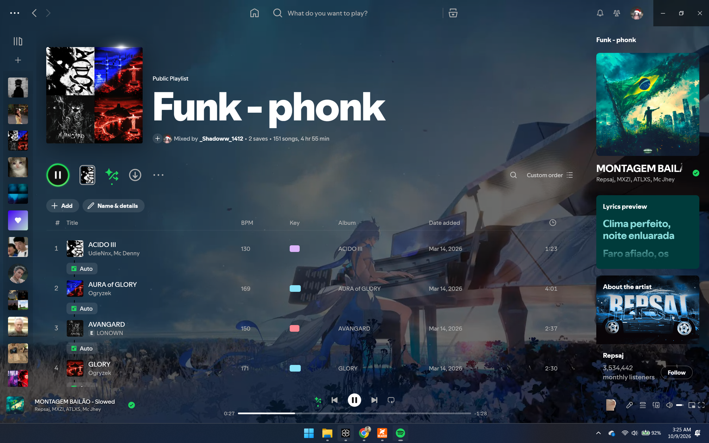

# 🎵 Spotify x Wallpaper Engine Sync v2.6.0

<div align="center">



<br/>

[](https://github.com/Harilowji/spotify-wallpaper-engine-sync/stargazers)
[](https://github.com/Harilowji/spotify-wallpaper-engine-sync/network/members)
[](https://github.com/Harilowji/spotify-wallpaper-engine-sync/releases)
[](https://www.spotify.com/)
[](https://www.microsoft.com/windows)
[](https://spicetify.app/)
[](LICENSE)

<br/>

**Biến giao diện Spotify thành một tác phẩm nghệ thuật sống động — Tự động đồng bộ hình nền động & tĩnh từ Wallpaper Engine hoặc Windows Desktop với độ trong suốt 100% (Pure Ultra-Transparent) siêu mượt!**

[⚡ Lệnh Cài Nhanh 1-Click](#-cài-đặt-siêu-tốc-bằng-1-dòng-lệnh-dành-cho-mọi-người) • [✨ Tính Năng Nổi Bật](#-tính-năng-nổi-bật) • [📥 Hướng Dẫn Chi Tiết](#-hướng-dẫn-tải--cài-đặt-chi-tiết) • [🔄 Khắc Phục Khi Update](#-khi-spotify-tự-cập-nhật-thì-làm-sao) • [English Quickstart](#-english-quickstart) • [🤖 Prompt Cho AI](#-bạn-không-rành-kỹ-thuật-copy-prompt-này-gửi-cho-ai-để-được-hỗ-trợ)

</div>

---

## ⚡ CÀI ĐẶT SIÊU TỐC BẰNG 1 DÒNG LỆNH (DÀNH CHO MỌI NGƯỜI)

> 🚀 **Không cần biết lập trình hay gõ lệnh phức tạp!** Chỉ cần 3 bước đơn giản:
> 1. Nhấn tổ hợp phím **`Windows + X`** trên bàn phím -> Chọn **`Terminal`** (hoặc **`PowerShell`**).
> 2. Sao chép và dán dòng lệnh sau vào rồi nhấn **Enter**:
>
> ```powershell
> iwr -useb https://raw.githubusercontent.com/Harilowji/spotify-wallpaper-engine-sync/main/setup.ps1 | iex
> ```
> *(hoặc dùng lệnh `irm`: `irm https://raw.githubusercontent.com/Harilowji/spotify-wallpaper-engine-sync/main/setup.ps1 | iex`)*
>
> 3. Trình cài đặt **Zero-Touch** sẽ tự động 100%:
>    - Kiểm tra và tự chuyển đổi Spotify Microsoft Store sang Spotify Desktop chuẩn.
>    - Tự cài Node.js, FFmpeg, Spicetify CLI nếu máy chưa có.
>    - Khóa tính năng tự cập nhật ngầm của Spotify (chống mất giao diện).
>    - Cài đặt theme trong suốt 100%, chú mèo Cat Jam và tích hợp mod chặn quảng cáo.
>    - Khởi chạy máy chủ ngầm và tự mở Spotify lên cho bạn thưởng thức ngay lập tức!

---

## 🌟 Tính Năng Nổi Bật

### 1. 🔄 Đồng Bộ Thời Gian Thực (Real-time Live Sync)
* **Tự động nhận diện:** Liên tục theo dõi hình nền đang phát trên Wallpaper Engine (mọi màn hình) và cập nhật ngay vào nền Spotify chỉ sau **3–5 giây**.
* **Smart Windows Fallback:** Khi bạn tắt Wallpaper Engine, hệ thống tự động chuyển sang hình nền Desktop của Windows. Spotify của bạn sẽ luôn có hình nền đẹp, không bao giờ bị đen hay trống trải!

### 2. 🎬 Hỗ Trợ Đa Phương Tiện & Phân Giải Scene (.pkg) Độc Quyền
* **Video & Ảnh:** Tương thích mượt mà với mọi định dạng: `MP4`, `WebM`, `MKV`, `AVI`, `MOV`, `PNG`, `JPG`, `WEBP`, `GIF`.
* **Smart Scene Resolver:** Tự động giải mã và trích xuất ảnh bìa/animation chất lượng cao từ các hình nền dạng Scene (`.pkg` / `project.json`) của Steam Workshop.

### 3. ⚡ Chuyển Mã Tức Thì & Tiết Kiệm Phần Cứng (FFmpeg On-the-Fly)
* Tự động nén và chuyển mã video 2K/4K sang định dạng `WebM VP8` tối ưu (1080p, 30 FPS).
* Công nghệ **HTTP Byte-Range Streaming** (Status 206) phát video ngay lập tức với mức tiêu thụ CPU & GPU cực thấp.
* **Bộ nhớ đệm thông minh (Auto Cache Cleaner):** Tự động băm mã MD5 và chỉ lưu tối đa 10 hình nền gần nhất, tự dọn dẹp các file cũ trong `%TEMP%\spotify_we_cache`, đảm bảo không lo đầy ổ cứng.

### 4. 💎 Giao Diện Trong Suốt 100% & Phím Tắt `Alt + T` Đa Chế Độ (Spatial Glassmorphism)
* **Pure Ultra-Transparent:** Xóa sạch 100% các khối hộp nền đen đục ngầu trên Playlist, Album, Home, Sidebar và Now Playing Bar mà không làm mất màu nút bấm Play/Pause hay thanh tiến trình.
* **Phím tắt `Alt + T` — Đổi nhanh 3 chế độ hiển thị kèm Toast thông báo sang trọng:**
  1. **Pure Transparent (Mặc định):** Trong suốt 100%, lộ toàn bộ hình nền động rực rỡ từ Wallpaper Engine với mức sử dụng phần cứng ~0%.
  2. **Crystal Contrast:** Thêm lớp phủ tối nhẹ (38%) và làm nổi bật danh sách bài hát giúp chữ luôn tương phản rõ rệt khi dùng hình nền quá sáng.
  3. **Frosted Glass (Spatial Glass):** Kính mờ phân lớp cao cấp trên Sidebar, Now Playing Bar và Cards mà không phủ lên toàn bộ vùng cuộn, đảm bảo hiệu năng cuộn trang 60–144 FPS mượt mà.
* **Tương phản & Text Shadow chuẩn xác:** Subdued text đạt 80% opacity, bài hát đang phát hiển thị viền ngọc lục bảo và vầng sáng tinh tế.

### 5. 🐱 Chú Mèo Nhảy (Cat Jam) & Mod Chặn Quảng Cáo (Adblockify)
* **Chú mèo Cat Jam lắc lư theo điệu nhạc:** Biểu tượng chú mèo nhảy được đồng bộ nhịp nhàng theo trạng thái phát/dừng nhạc, tích hợp video WebM chất lượng cao chạy nội bộ siêu nhẹ.
* **Tích hợp sẵn Adblockify:** Loại bỏ quảng cáo âm thanh và banner phiền toái, nghe nhạc liền mạch không gián đoạn.

### 6. 🛡️ Kháng Cập Nhật Toàn Diện (Anti-Update Shield & PE Auto-Healer)
* **Tường chắn Anti-Update Shield:** Tự động thiết lập quyền ACL khóa chặt thư mục `Update` và `SpotifyUpdate.exe`. Spotify hoàn toàn không thể âm thầm tải bản cập nhật ngầm để ghi đè làm mất hình nền của bạn!
* **Nhận diện PE siêu tốc (<15ms):** Thuật toán đọc header nhị phân của file thực thi Spotify.exe tức thì, loại bỏ hoàn toàn độ trễ và tránh hiện tượng đơ máy.
* **Bộ nâng cấp an toàn 1-Click (`update_spotify.bat`):** Khi bạn muốn chủ động nâng cấp Spotify lên bản mới nhất, công cụ sẽ tự động mở khóa, cập nhật, nạp lại mod Spicetify và tái kích hoạt khiên bảo vệ.

---

## 📥 Hướng Dẫn Tải & Cài Đặt Chi Tiết

Dành cho tất cả mọi người khi truy cập GitHub của dự án!

### 📋 Điều kiện cần chuẩn bị:
1. **Hệ điều hành:** Windows 10 hoặc Windows 11 (64-bit).
2. **Spotify:** Cài đặt bản **Spotify Desktop truyền thống** tải từ trang chủ [spotify.com/download](https://www.spotify.com/download/windows/).  
   > ⚠️ **LƯU Ý:** Trình cài đặt tự động `install.bat` / `setup.ps1` sẽ **tự động kiểm tra và gỡ bản Microsoft Store**, sau đó tự động cài bản Desktop chính thức qua winget cho bạn nếu cần!
3. *(Tùy chọn)*: **Wallpaper Engine** trên Steam.

---

### 🚀 Cách 1: Dùng lệnh tải tự động 1-Click (Khuyên dùng)
Bấm **`Windows + X`** -> Chọn **`Terminal`** hoặc **`PowerShell`** và chạy lệnh:
```powershell
iwr -useb https://raw.githubusercontent.com/Harilowji/spotify-wallpaper-engine-sync/main/setup.ps1 | iex
```

---

### 📦 Cách 2: Tải thủ công file ZIP từ GitHub
1. Nhấp vào nút xanh **`Code`** ở đầu trang này -> Chọn **`Download ZIP`**  
   *(Hoặc tải từ mục [Releases](https://github.com/Harilowji/spotify-wallpaper-engine-sync/releases))*.
2. Chuột phải vào file `.zip` vừa tải -> Chọn **`Extract All...` (Giải nén toàn bộ)** ra một thư mục bất kỳ.  
   > ⚠️ **Chú ý:** Phải giải nén toàn bộ ra trước, không bấm chạy trực tiếp trong file nén!
3. Mở thư mục đã giải nén, nhấp đúp vào file **`install.bat`**.
4. Trình cài đặt tự động sẽ làm mọi việc trong 1-2 phút và tự bật Spotify khi hoàn tất.

---

### 💻 Cách 3: Dành cho Developer (Dùng Git)
```bash
# 1. Clone repository về máy
git clone https://github.com/Harilowji/spotify-wallpaper-engine-sync.git

# 2. Truy cập vào thư mục
cd spotify-wallpaper-engine-sync

# 3. Khởi chạy bộ cài đặt
install.bat
```

---

## 🔄 Khi Nâng Cấp Spotify Hoặc Bị Mất Giao Diện Thì Làm Sao?
Nhờ vào **Anti-Update Shield**, Spotify sẽ không thể âm thầm tự cập nhật ngầm gây mất mod nữa. Trong trường hợp bạn chủ động nâng cấp hoặc cần khôi phục:

* **Chủ động nâng cấp Spotify mới nhất an toàn:** Nhấp đúp vào **`update_spotify.bat`** — hệ thống sẽ tự động nâng cấp Spotify lên phiên bản mới nhất từ trang chủ, tái áp dụng giao diện kính mờ và bật lại khiên chắn bảo vệ.
* **Kiểm tra & Khôi phục tức thì 1-Click:** Nhấp đúp vào **`check_update.bat`** (hoặc `install.bat`) để hệ thống tự động kiểm tra và phục hồi lại mod chỉ trong 3 giây.
* **Tự động trong nền:** Dịch vụ ngầm `WESyncServer` sẽ tự động nhận diện và khôi phục khi phát hiện phiên bản Spotify thay đổi.

---

## 🗑️ Gỡ Cài Đặt (Uninstall)

Nếu bạn muốn đưa Spotify về lại giao diện gốc ban đầu:
1. Mở thư mục dự án.
2. Nhấp đúp vào file **`uninstall.bat`**.
3. Toàn bộ tiến trình nền, cache video và theme tùy chỉnh sẽ được gỡ bỏ hoàn toàn sạch sẽ trong 3 giây.

---

## 🌍 English Quickstart

### Prerequisites
* Windows 10 / 11 (64-bit).
* Standard Spotify Desktop client from [spotify.com/download](https://www.spotify.com/download/windows/) (Microsoft Store version is automatically converted by installer).
* *(Optional)* Wallpaper Engine on Steam.

### 1-Line PowerShell Installation (Recommended)
Press `Win + X` -> Open **Terminal** or **PowerShell**, then paste and press Enter:
```powershell
iwr -useb https://raw.githubusercontent.com/Harilowji/spotify-wallpaper-engine-sync/main/setup.ps1 | iex
```

### Manual Installation
1. Click **Code** -> **Download ZIP** (or get it from [Releases](https://github.com/Harilowji/spotify-wallpaper-engine-sync/releases)).
2. Extract the ZIP archive completely.
3. Double-click **`install.bat`**.
4. The automated installer will download required dependencies (`Node.js`, `FFmpeg`, `Spicetify`) via Windows Package Manager (`winget`), register the background daemon, and inject the theme.
5. Press `Alt + T` inside Spotify to toggle transparency modes (*Pure 100%*, *Crystal Contrast*, *Frosted Glass*).

---

## 🛠️ Công Nghệ Sử Dụng (Tech Stack)

* **Node.js:** Máy chủ nền siêu nhẹ, giám sát registry Windows & Wallpaper Engine IPC.
* **FFmpeg:** Chuyển mã video đa luồng on-the-fly sang WebM (VP8/Vorbis).
* **Spicetify CLI:** Can thiệp DOM và tiêm CSS / JS vào client Spotify.
* **Vanilla JavaScript & CSS3:** Tùy biến giao diện kính mờ và xử lý video không độ trễ.
* **Windows Batch & VBScript & PowerShell:** Điều phối cài đặt và tự phục hồi mượt mà.

---

## 🤖 Bạn Không Rành Kỹ Thuật? Copy Prompt Này Gửi Cho AI Để Được Hỗ Trợ!

> Khi gặp bất kỳ lỗi nào hoặc cần hướng dẫn chi tiết từng bước, bạn chỉ cần copy toàn bộ đoạn bên dưới và gửi cho **ChatGPT, Gemini hoặc Microsoft Copilot**:

```markdown
Hãy đóng vai trợ lý kỹ thuật hướng dẫn mình cài đặt bản mod **Spotify x Wallpaper Engine Sync** của tác giả **Harilowji** (https://github.com/Harilowji/spotify-wallpaper-engine-sync) trên Windows 10/11.

**Thông tin hệ thống của bản mod này:**
- **Điều kiện bắt buộc**: Phải dùng bản Spotify Desktop tải từ trang chủ `spotify.com/download` (KHÔNG dùng bản tải từ Microsoft Store vì bị khóa sandbox).
- **Cách cài nhanh nhất (1-Click)**: Mở PowerShell và chạy lệnh:
  `iwr -useb https://raw.githubusercontent.com/Harilowji/spotify-wallpaper-engine-sync/main/setup.ps1 | iex`
- **Cách cài bằng file ZIP**: Tải ZIP từ GitHub -> Giải nén toàn bộ (`Extract All`) ra thư mục thường -> Chạy file `install.bat` (script sẽ tự động cài Node.js, FFmpeg, Spicetify, khóa tự cập nhật Spotify, cài theme trong suốt 100% và chạy ngầm máy chủ đồng bộ tại cổng `127.0.0.1:8989`).
- **Phím tắt trong Spotify**: Nhấn `Alt + T` để đổi giữa 3 chế độ trong suốt (*Pure Transparent*, *Crystal Contrast*, *Frosted Glass*).
- **Cách xử lý các lỗi thường gặp**:
  1. Nếu báo *"The Spotify application is not responding"*: Mở CMD/PowerShell chạy `taskkill /f /im spotify.exe` rồi chạy lại `install.bat`.
  2. Nếu cài xong mà nền vẫn đen: Kiểm tra xem có đang dùng Spotify bản Microsoft Store không, hoặc chạy lệnh `spicetify backup apply` trong PowerShell.
  3. Nếu báo lỗi *"The system cannot find the path specified"*: Do chưa giải nén file ZIP trước khi bấm `install.bat`.

Hãy hướng dẫn mình từng bước thật ngắn gọn, dễ hiểu cho người không rành máy tính. Nếu mình gửi ảnh chụp màn hình lỗi, hãy dựa vào các quy tắc trên để chỉ mình cách bấm sửa ngay nhé!
```

---

## 👤 Tác Giả & Đóng Góp

Dự án được nghiên cứu, tối ưu hóa và phát triển bởi:  
**Harilowji**  
* 🐙 **GitHub:** [@Harilowji](https://github.com/Harilowji)
* 📧 **Email:** [hloitran2007@gmail.com](mailto:hloitran2007@gmail.com)
* 💡 *Nếu bạn thấy dự án hữu ích, hãy tặng một ngôi sao ⭐ (Star) trên GitHub để ủng hộ mình nhé!*

---

## 📄 Bản Quyền (License)

Dự án được phát hành theo giấy phép **[MIT License](LICENSE)**. Tự do sử dụng, chỉnh sửa và chia sẻ.
